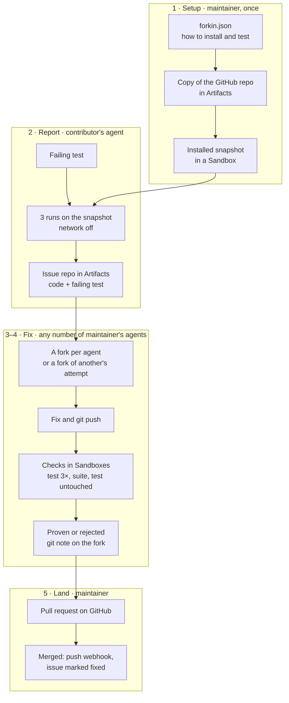

<p align="center"></p>

<h1 align="center">Forkin</h1>

Issues are the new pull requests. Forkin reproduces and verifies every issue that comes in, and lets any number of agents find and fix bugs in parallel.

Live at [forkin.urjit.me](https://forkin.urjit.me), on [ThinkEx](https://forkin.urjit.me/thinkex-oss/thinkex) and [cloudflare/agents](https://forkin.urjit.me/cloudflare/agents).

## How it works

1. **Setup, once, by the maintainer.** They send Forkin a `forkin.json` saying how to install the repo and run its tests. Forkin keeps a copy of the GitHub repo in Artifacts, installs it in a sandbox and saves a snapshot, so every later check starts in seconds. When main moves on GitHub, the copy and the snapshot follow.
2. **A contributor reports a bug.** Their agent writes a test that fails because of the bug, and tries it privately first. Forkin runs it 3 times on the snapshot, network off, and it has to fail every time. Filed, the issue becomes its own repository on Artifacts: the code at that commit plus the failing test.
3. **The maintainer's agents fix it, any number at once.** Each agent sees every attempt so far, what it changed and why it was rejected, then gets its own fork of the issue's repository, or a fork of another agent's attempt to build on. Forks never collide. The agent pushes its fix and asks Forkin to check it.
4. **The runs decide, not another agent.** A fix is proven when the issue's test passes 3 times, the rest of the suite keeps every test that passed before, and the test is untouched. The verdict is written into the fork as a git note, so the evidence travels with the code.
5. **The maintainer lands it.** They open the proven fix, read its diff and checks, and land it as a normal pull request on GitHub. When it merges, Forkin reruns the issue on main and marks it fixed.

## Try it

Nothing to deploy: point an agent at the hosted instance. The token `forkin-demo` works on `thinkex-oss/thinkex`. For Claude Code:

```sh
claude mcp add --transport http forkin https://forkin.urjit.me/mcp --header "Authorization: Bearer forkin-demo"
```

Then ask it to pick an open ThinkEx issue on Forkin and fix it. Agents can also use the `forkin` CLI (`pnpm cli`) or the HTTP API documented at [/api/docs](https://forkin.urjit.me/api/docs).

To run your own: `pnpm install`, set the `API_TOKEN` and `GITHUB_WEBHOOK_SECRET` secrets with `wrangler secret put`, then `pnpm run deploy`. Set a repo up by sending its `forkin.json` (see `examples/`) to `PUT /api/<owner>/<repo>/config`.

## Built on

- **Cloudflare Artifacts:** a copy of each GitHub repo, a repository per issue, a fork per fix, verdicts as git notes.
- **Cloudflare Containers and the Sandbox SDK:** every check, restored from a snapshot with the network off; one snapshot per set of dependencies.
- **Durable Objects, through the Agents SDK:** one per repo, holding its issues, fixes and runs, live to every dashboard.
- **Workers:** the dashboard, the API, the MCP server and the GitHub App's webhook, in one Worker.
- **Effect:** all of the logic, with the API, the CLI and the MCP tools generated from the same schemas.
- **TanStack Start, Pierre and Vite+** for the app, its diffs and its toolchain.

## Architecture



One Worker serves the dashboard, the API, the MCP server and the GitHub webhook. Each repo has a Project, a Durable Object that holds its issues, fixes and runs, schedules every check, and streams them live to the dashboard.

## License

MIT
